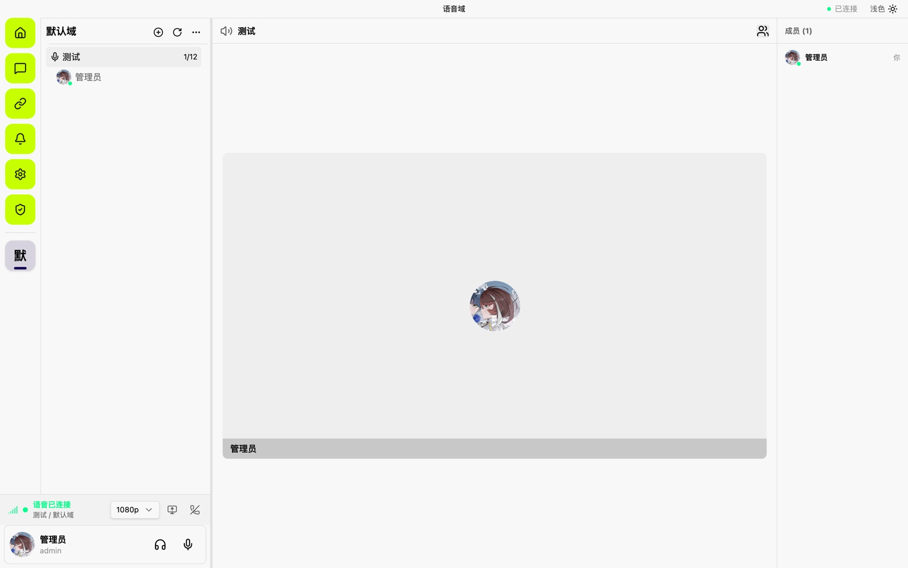
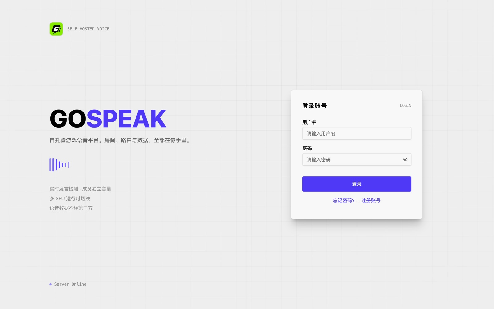
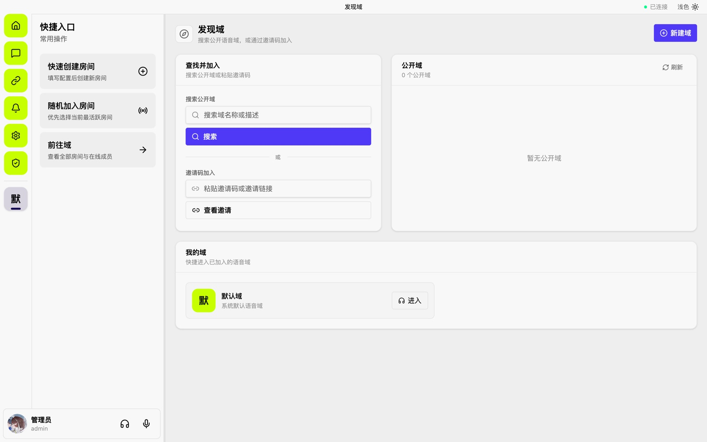

<div align="center">
  

  <h1>GOSpeak</h1>

  <p>
    <a href="https://go.dev" target="_blank"></a>
    <a href="https://react.dev" target="_blank"></a>
    <a href="https://www.livekit.io" target="_blank"></a>
    <a href="https://www.apache.org/licenses/LICENSE-2.0" target="_blank"></a>
    <a href="https://awesomemygo.dev/apps/gospeak" target="_blank"></a>
    <a href="https://gospeak.noelorin.top" target="_blank"></a>
  </p>
</div>

GOSpeak 是一个自托管的游戏语音平台，基于 LiveKit 提供音视频能力。单个二进制即可运行，前端内嵌，提供语音房间、发言检测、逐人音量控制、房间权限与原生桌面客户端。

## 界面预览

<div align="center">
  
  <p><em>语音房间 — 频道树、发言检测、成员面板与逐人音量</em></p>
</div>

<table>
  <tr>
    <td width="50%"><br /><em>登录页 — 自托管实例，无第三方鉴权依赖</em></td>
    <td width="50%"><br /><em>发现域 — 公开域检索、邀请码加入与已加入域快捷入口</em></td>
  </tr>
</table>

## 特性

- 文字消息：频道与私聊会话，支持提及与表情回应。
- 语音房间：创建与加入，支持密码保护与人数上限。
- 发言检测：实时语音活动指示，显示当前正在说话的成员。
- 逐人音量：为每位成员单独调节输出音量，设置持久保存。
- 麦克风与静音：一键闭麦、一键静音所有声音。
- 房间管理：创建者与管理员可强制静音、踢出成员、全员静音。
- 角色权限：完整的角色权限体系。
- 单二进制部署：前端通过 `go:embed` 内嵌，下载即用。
- 同源 LiveKit：内置 `/livekit` 反向代理，信令走应用域名，媒体走 WebRTC UDP 直连。
- 内置 Caddy：传入域名即可自动申请 HTTPS 证书并处理 WebSocket 升级。
- 渐进式数据库：SQLite、PostgreSQL、MySQL，由 GORM 自动迁移。
- 多种认证方式：JWT 与 OAuth2（GitHub、Google、QQ）。
- 可选组件：对象存储（RustFS、R2）与可观测性（Prometheus、Grafana、Loki）。
- 原生桌面客户端：关窗进托盘、开机自启、全局快捷键、系统通知、游戏内覆盖层，与网页版共用同一套前端。
- 前端错误边界：组件、页面、路由三层兜底与全局错误上报。

## 快速开始

### 在线体验

不想先部署？直接访问演示站 [gospeak.noelorin.top](https://gospeak.noelorin.top) 体验完整功能。

### 单二进制

从 [Releases](https://github.com/NoelOrin/GOSpeak/releases) 下载对应平台的 `gospeak-*` 文件，前端已内嵌，无需其他依赖。

```bash
chmod +x gospeak-server-v1.0.0-linux-amd64
./gospeak-server-v1.0.0-linux-amd64 server -e prod
```

浏览器打开 `http://<host>:8998`。首次启动自动创建管理员账号，用户名 `admin`，默认密码 `admin123`，生产环境请立即修改。

### 源码开发

需要 Go 1.26+、Node.js 20+、pnpm 10+ 与 Docker。

```bash
git clone https://github.com/NoelOrin/GOSpeak.git
cd GOSpeak
pnpm install

cd deploy && ./init.sh && cd ..
docker compose -f deploy/docker-compose.yml up -d
pnpm start:dev
```

`./init.sh` 生成唯一配置文件 `deploy/.env`，并随机写入 LiveKit 凭证。本地 LiveKit 容器的 7880 端口绑定到宿主机回环地址，后端直连即可。

## 部署

完整说明见 [deploy/DEPLOY.md](deploy/DEPLOY.md)。部署只需要一个域名与一个上游。

### 使用域名

```bash
cd deploy
./init.sh --domain voice.example.com
docker compose up -d --build
```

`--domain` 将 `edge` 加入 `COMPOSE_PROFILES`，内置 Caddy 自动申请 HTTPS 证书并处理 WebSocket 升级。浏览器打开 `https://voice.example.com`。

### 使用已有反向代理

```bash
cd deploy
./init.sh
docker compose up -d --build
```

不传 `--domain`。将反向代理指向 `gospeak:8998` 这一个上游。`/api`、`/ws`、`/uploads`、`/livekit` 全部由应用提供，LiveKit 不需要单独的域名、证书或代理规则。Nginx 配置示例见 [app/docs/deploy/nginx.md](app/docs/deploy/nginx.md)。

### 局域网

不传 `--domain`，直接访问 `http://<IP>:8998`。浏览器麦克风需要 localhost 或 HTTPS。

### 端口

放行 `80/443`（反向代理）、`7882/tcp+udp`（媒体）、`3478/udp`（TURN）。7880 仅绑定宿主机回环地址用于本地调试，信令经同源 `/livekit` 代理。

### 可选组件

```env
DB_TYPE="SQLite"                                      # 默认，无外部依赖
DB_TYPE="PostgreSQL"  DB_HOST=postgres  DB_PORT=5432  # 或在 COMPOSE_PROFILES 追加 postgres

# COMPOSE_PROFILES 可选档位
# rustfs         对象存储
# observability  Prometheus + Grafana + Loki
```

## 桌面客户端

桌面客户端与网页版共用同一套前端，提供浏览器不具备的能力：关窗进托盘、全局快捷键（在游戏内生效）、开机自启、系统通知、游戏内覆盖层。构建与开发说明见 [app/desktop/README.md](app/desktop/README.md) 与 [桌面客户端文档](app/docs/guide/desktop.md)。

## 文档

- [部署指南](./docs/deployment-guide.md)
- [桌面客户端](./app/docs/guide/desktop.md)
- [SFU 配置与成熟度](./docs/sfu-provider-maturity.md)
- [架构设计](./ARCHITECTURE.md)
- [开发者指南与 API 路由表](./AGENTS.md)

## 贡献

欢迎提交 PR 与 Issue，较大的改动请先开 Issue 讨论。提交信息遵循 [Conventional Commits](https://www.conventionalcommits.org/)，由 commitlint 与 lefthook 强制执行。

## License

Apache 2.0，见 [LICENSE](./LICENSE)。
